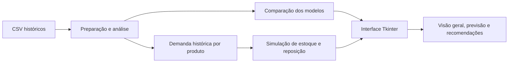
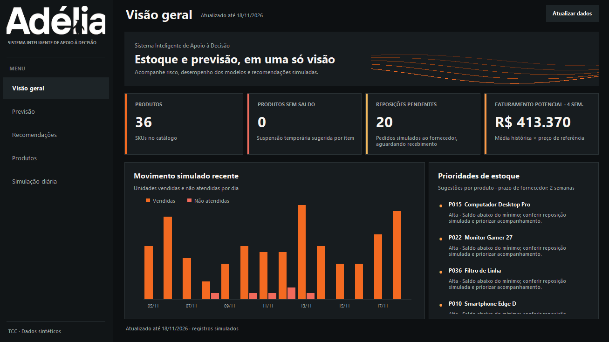

# ADÉLIA

<p align="center">
  
</p>

<p align="center"><strong>Sistema Inteligente de Apoio à Decisão</strong><br>Projeto de conclusão de curso em Ciência de Dados</p>

## Sobre o projeto

A ADÉLIA reúne análise de vendas, previsão de demanda e recomendações de estoque em uma interface desktop feita com Tkinter. O estudo usa uma base fictícia de vendas de produtos de tecnologia.

O objetivo é transformar o histórico em informações que ajudem a comparar modelos, identificar risco de falta de estoque e apoiar decisões de reposição.

## O que o sistema apresenta

- **Visão geral:** resumo do estoque simulado, reposições pendentes e faturamento bruto potencial.
- **Faturamento futuro:** estimativa para 4 ou 8 semanas pela média semanal das últimas 8 semanas históricas, multiplicada pelo preço de referência.
- **Comparação de modelos:** diagnósticos por produto e horizonte; MAE e WAPE são explicados dentro da interface.
- **Recomendações:** alertas por produto considerando saldo, estoque mínimo, cobertura estimada e reposições simuladas.
- **Simulação diária:** vendas hipotéticas, unidades não atendidas, pausa por produto sem saldo e pedidos simulados com prazo de fornecedor de 2 semanas.

## Como interpretar os termos

- **Produto sem saldo:** a quantidade disponível desse item chegou a zero. A sugestão é suspender temporariamente a venda somente desse produto até receber reposição e recuperar o estoque mínimo. Se o saldo for positivo, mas ainda estiver abaixo do mínimo, a interface mostra “Suspensão sugerida”. Essas mensagens são recomendações; não alteram uma loja real.
- **Reposição pendente:** pedido simulado ao fornecedor aguardando recebimento. Não é um pedido de cliente e não significa uma venda futura.
- **Cobertura estimada:** saldo disponível dividido pela média semanal de vendas históricas; indica quantas semanas o estoque duraria se o ritmo médio se mantivesse.
- **MAE:** diferença média entre quantidade prevista e quantidade real, em unidades. Menor indica menor erro médio.
- **WAPE:** erro total em relação ao volume real, em porcentagem. Menor indica menor erro relativo.
- **Faturamento bruto potencial:** média histórica de unidades × horizonte × preço de referência. É uma estimativa orientativa; não desconta falta de estoque, descontos, custos ou devoluções.

## Fluxo do projeto



## Tecnologias

- Python 3.14
- Tkinter para a interface desktop
- pandas e NumPy para manipulação dos dados e simulação
- scikit-learn para os modelos preditivos
- Jupyter Notebook para análise e avaliação

O Tkinter acompanha a instalação padrão do Python para Windows. Para os notebooks e rotinas de análise, instale as bibliotecas necessárias no ambiente Python:

```powershell
python -m pip install pandas numpy scikit-learn jupyter
```

## Como executar

A partir da pasta raiz do projeto, abra o painel:

```powershell
python src/interface_tkinter.py
```

A interface lê os arquivos de `DATA/`, o estado atual em `DATA_SIMULADA_2_SEMANAS/` e as tabelas de diagnóstico salvas no notebook `NOTEBOOKS/02_modelagem_de_previsão.ipynb`.

Para gerar ou atualizar manualmente a simulação de vendas e estoque:

```powershell
python src/atualizar_simulacao_diaria.py
```

No computador usado no desenvolvimento, essa rotina também está configurada no Agendador de Tarefas do Windows. Essa configuração é local; quem clonar o repositório precisará executá-la manualmente ou configurar sua própria tarefa agendada.

## Estrutura principal

```text
ADELIA/
├── DATA/                         # CSVs históricos fictícios
├── DATA_SIMULADA_2_SEMANAS/      # saídas da simulação de estoque
├── NOTEBOOKS/                    # conferência, modelagem e avaliação
├── assets/                       # identidade visual e logo
├── reports/                      # gráficos e relatórios do projeto
└── src/                           # interface e rotina diária
```

## Capturas de tela

Capturas ajudam a apresentar o sistema no GitHub. Recomendo incluir a visão geral, a tela de faturamento e a tabela de recomendações. Salve as imagens em `docs/images/` com nomes simples, por exemplo `visao-geral.png`, e adicione cada uma assim:

```markdown

```

Use capturas sem informações pessoais e confira se os textos estão legíveis antes de publicá-las.

## Observações e limitações

Os CSVs históricos usados pelo estudo são fictícios. Os registros da simulação também são hipotéticos e permanecem separados do histórico. O faturamento futuro é uma estimativa baseada na média recente, não uma garantia de receita nem uma previsão financeira ajustada à disponibilidade de estoque.

As recomendações servem como apoio à análise acadêmica. Elas não enviam pedidos a fornecedores nem suspendem vendas em um sistema real.
